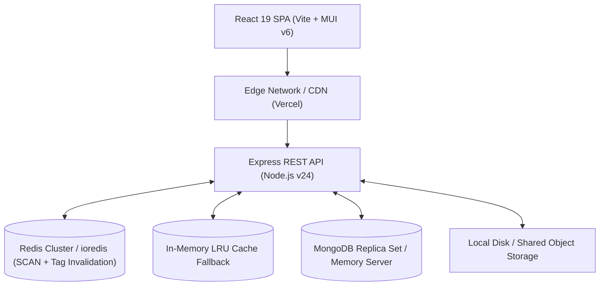
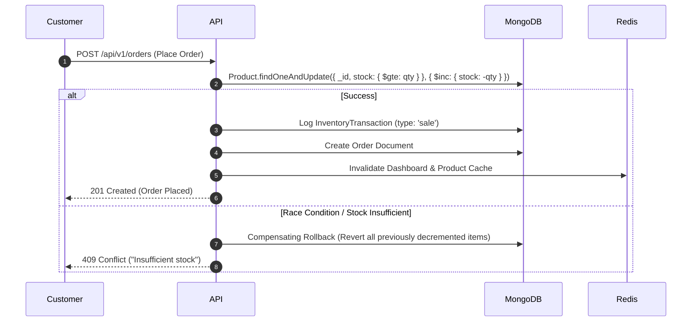
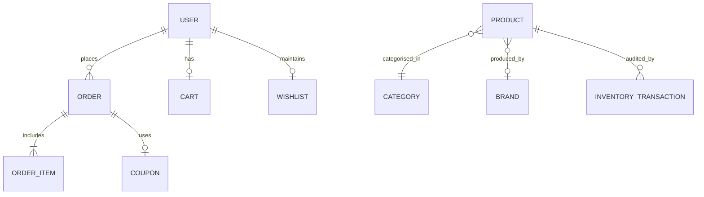
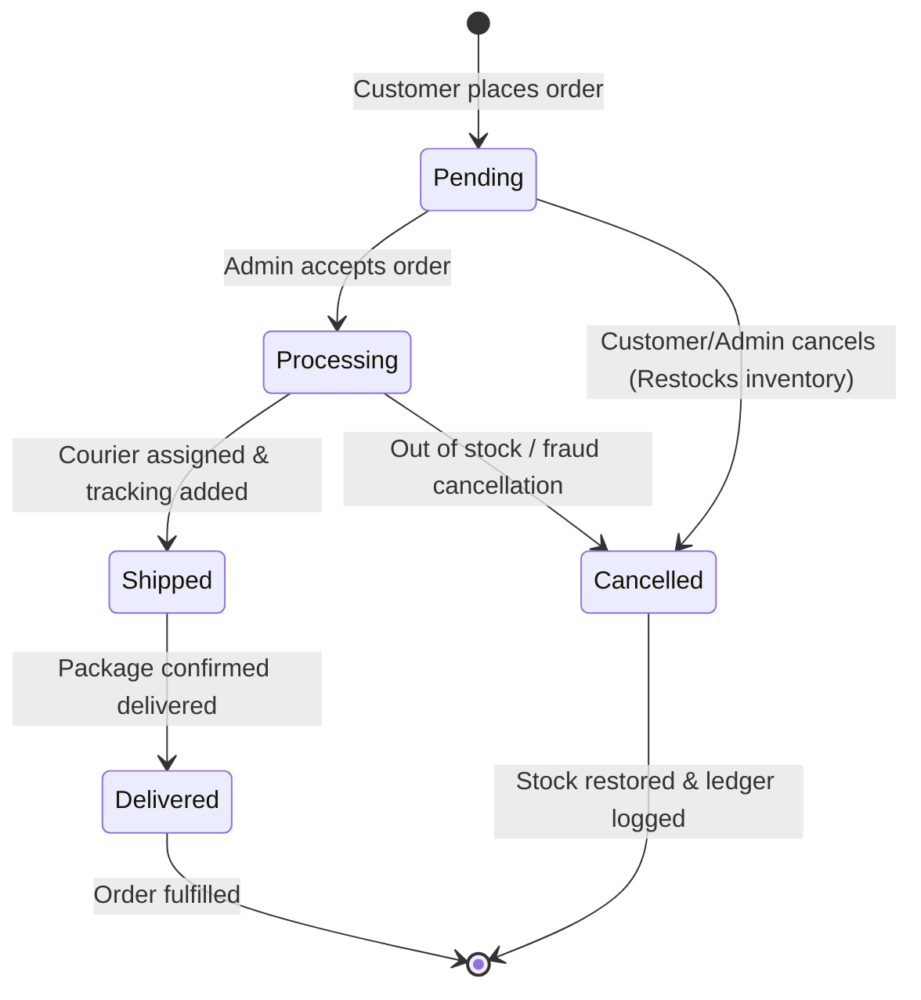

# 🛍️ NovaStore - Full-Stack Architecture, Codebase & Product Overview

> **Repository Master Guide & Comprehensive System Analysis**  
> *Compiled from Software Architect, Software Developer, and Product Manager Perspectives.*

For the complete documentation with setup instructions, diagrams, and operational guides, see [README.md](file:///d:/e-com/README.md).

---

## 📑 Quick Navigation
- [1. Executive Summary](#1-executive-summary)
- [2. Software Architect Perspective](#2-software-architect-perspective)
  - [System Topology & Infrastructure](#system-topology--infrastructure)
  - [Caching & Invalidation Strategy](#caching--invalidation-strategy)
  - [Inventory Concurrency & Data Consistency](#inventory-concurrency--data-consistency)
  - [Entity-Relationship Diagram](#entity-relationship-diagram)
- [3. Software Developer Perspective](#3-software-developer-perspective)
  - [Monorepo Structure](#monorepo-structure)
  - [Controller-Service-Repository Pattern](#controller-service-repository-pattern)
  - [Frontend Performance & Bundle Splitting](#frontend-performance--bundle-splitting)
  - [Security Implementation & Error Handling](#security-implementation--error-handling)
  - [Integration Testing](#integration-testing)
- [4. Product Manager Perspective](#4-product-manager-perspective)
  - [Feature Matrix & User Journeys](#feature-matrix--user-journeys)
  - [Order Lifecycle State Machine](#order-lifecycle-state-machine)
  - [Conversion Rate Optimization (CRO)](#conversion-rate-optimization-cro)
- [5. Actionable Strategic Roadmap](#5-actionable-strategic-roadmap)

---

## 1. Executive Summary

NovaStore is an enterprise-grade full-stack e-commerce platform built with React 19, Material UI (MUI v6), Node.js v24+, Express, Redis, and MongoDB. The system features a decoupled, stateless REST API architecture, atomic inventory reservations, multi-tier caching (Edge SWR + Redis + In-Memory auto-fallback), and an automated admin operations console.

---

## 2. Software Architect Perspective

### System Topology & Infrastructure

### Caching & Invalidation Strategy
The architecture deploys dual-engine multi-tier caching:
1. **Client Edge**: `cacheManager` caches static and read-heavy endpoints (`/home`, `/categories`, `/brands`, `/products`) in memory with `sessionStorage` persistence and promise deduplication.
2. **Server Level**: `ioredis` with route-level caching middleware (`cacheRoute`) and domain-based selective invalidation:
   - Updating products purges `products:*`, `home:*`, and `dashboard:*`.
   - Modifying categories purges `categories:*`, `products:*`, and `home:*`.
   - Creating an order immediately purges `dashboard:*` and `products:*`.

### Inventory Concurrency & Data Consistency

### Entity-Relationship Diagram

---

## 3. Software Developer Perspective

### Monorepo Structure
- Monorepo workspace with `client/` and `server/` managed via root `package.json`.
- Zero-dependency local setup: embedded `mongodb-memory-server` boots automatically if local MongoDB is not running, and in-memory caching engages if Redis is offline.

### Controller-Service-Repository Pattern
- **Controllers** handle HTTP parameters, query parsing, and response envelope formatting.
- **Services** encapsulate core domain logic (`orderService.js`, `cartService.js`, `productService.js`, etc.) ensuring modular testability and reusability.

### Frontend Performance & Bundle Splitting
- **Code-Splitting**: All store, account, and admin routes use `React.lazy()` with `Suspense` fallbacks.
- **Vite Granular Chunks**: Splits vendor dependencies into `vendor-core` (React/MUI), `vendor-icons`, and `vendor-axios`.
- **Dynamic Image Acceleration**: Unsplash image URLs are rewritten on the fly to WebP/AVIF with optimized widths and responsive `srcSet`.
- **Zero-Dependency Sound Synthesis**: Audio oscillators generate custom order chimes and buzzer alerts via the browser's native `AudioContext`.

### Security Implementation & Error Handling
- **JWT Authentication**: Dual-token mechanism (1d access token, 7d refresh token) transmitted in HTTP-only, secure cookies with header fallback.
- **Role-Based Guards**: `requireAuth` and `requireRole('admin')` enforce strict RBAC across admin routes.
- **Sanitized Inputs**: Regex escaping (`sanitizeRegex`) prevents ReDoS attacks, express-validator ensures strict typing, and Helmet sets secure HTTP headers.

### Integration Testing
- 11 automated integration tests run via native Node.js test runner (`node:test`) and `supertest`, validating authentication, catalog search, coupon rules, RBAC enforcement, dashboard aggregation, cart/order lifecycle, and cache hit/invalidation.

---

## 4. Product Manager Perspective

### Feature Matrix & User Journeys
1. **Storefront & Catalog**: Mega-search autocomplete, category hierarchy, price range slider, star rating filters, in-stock toggle, and URL query synchronization.
2. **Product Page**: High-resolution gallery, specifications table, variant selection (size/color), and verified buyer review submissions.
3. **Cart & Frictionless Checkout**: Automatic guest cart migration to user account upon authentication, server-validated coupon discounts, free shipping progress bar, and 3-step checkout stepper.
4. **Account Self-Service**: Multiple saved delivery addresses, detailed order timeline tracking, and customer self-cancellation.
5. **Admin Operations**: Gross revenue analytics, weekly trend bar charts, low-stock audit alerts, catalog CRUD, order fulfillment tracking, coupon generation, and store settings customization.

### Order Lifecycle State Machine

### Conversion Rate Optimization (CRO)
- Sub-second catalog browsing via client SWR cache eliminates page load drop-off.
- Guest cart retention in `localStorage` prevents lost intent before sign-in.
- Clear free-shipping threshold gamifies order size increase ($50 goal).
- Instant audio confirmation chime provides positive psychological purchase feedback.

---

## 5. Actionable Strategic Roadmap

| Horizon | Strategic Objective | Technical Scope | Business Value |
|---|---|---|---|
| **Immediate (Q1)** | Cloud Media Storage | Migrate from `/uploads` to AWS S3 / Cloudflare R2 | Enable stateless multi-instance autoscaling |
| **Immediate (Q1)** | Real Payment Gateway | Stripe Elements & Razorpay Webhook integration | Enable real credit card and digital wallet payments |
| **Medium-Term (Q2)** | Transactional Notifications | SendGrid email and Twilio SMS order updates | Improve customer communication and decrease support tickets |
| **Medium-Term (Q2)** | Distributed Rate Limiting | Connect `rate-limit-redis` to Redis cluster | Prevent distributed DDoS / brute force across replicas |
| **Long-Term (Q3)** | Abandoned Cart Recovery | Automated email triggers for inactive carts | Recover 10-15% of abandoned checkout intent |
| **Long-Term (Q3)** | Multi-Warehouse Inventory | Inventory allocation rules based on shipping address | Reduce fulfillment costs and delivery transit times |

---

*For detailed setup commands, environment variables, and testing scripts, see [README.md](file:///d:/e-com/README.md).*

