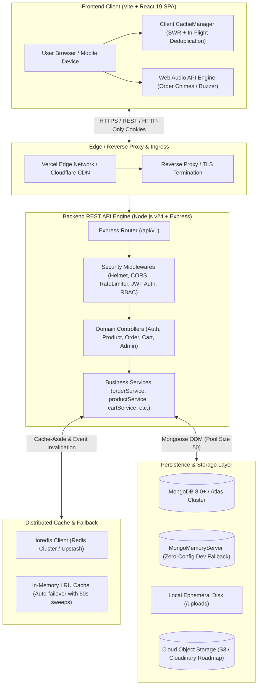
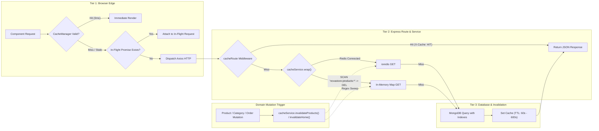
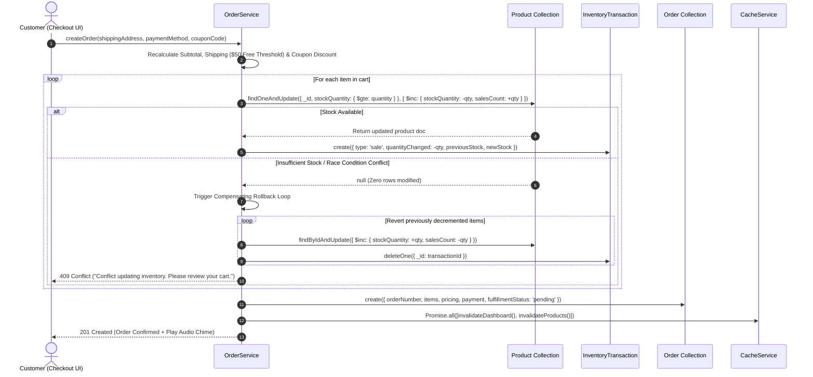
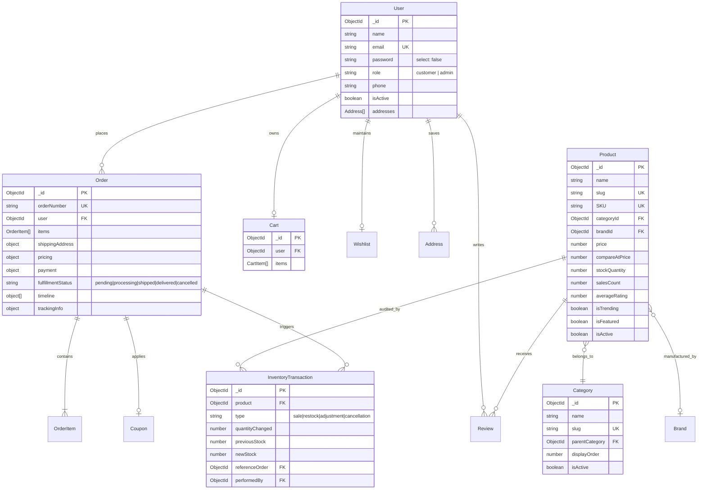
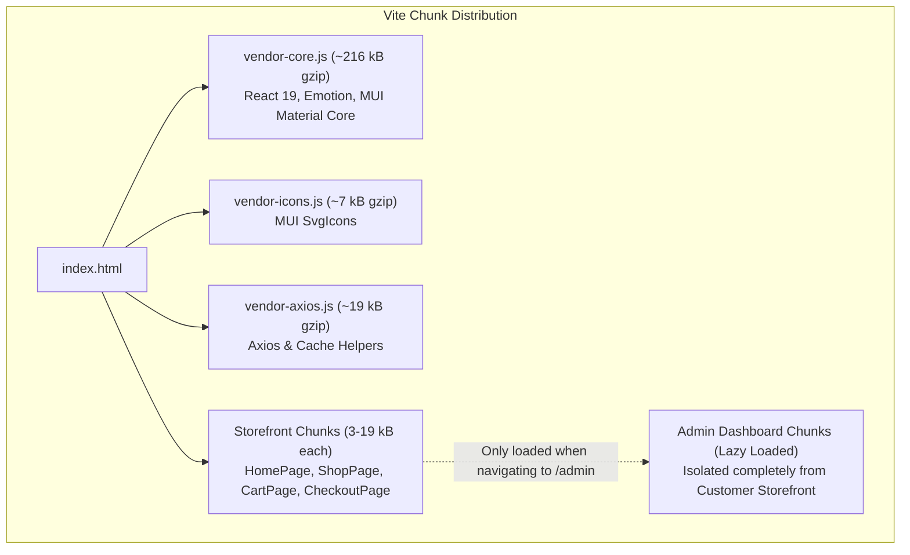
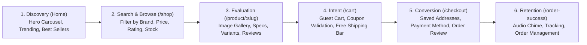
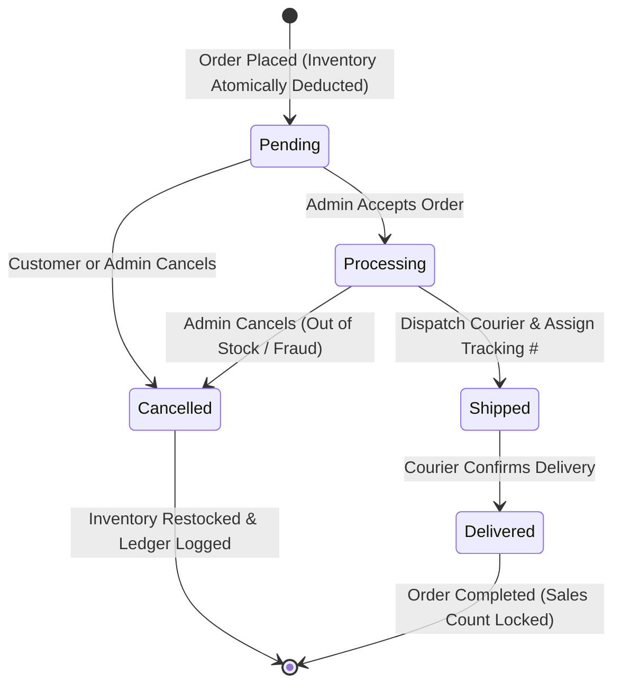

# 🛍️ NovaStore - Full-Stack Enterprise E-Commerce Platform

> **Comprehensive Architectural, Developer, and Product Overview**  
> *Engineered with React 19, Vite, Material UI (MUI v6), Node.js v24+, Express, Redis Multi-Tier Caching, and MongoDB.*

---

## 📑 Table of Contents
1. [Executive Summary](#-executive-summary)
2. [Software Architect Perspective: System Design & Scalability](#-software-architect-perspective-system-design--scalability)
   - [System Topology & High-Level Architecture](#system-topology--high-level-architecture)
   - [Multi-Tier Caching & Invalidation Architecture](#multi-tier-caching--invalidation-architecture)
   - [Transactional Integrity & Inventory Consistency](#transactional-integrity--inventory-consistency)
   - [Database Entity-Relationship (ER) Model](#database-entity-relationship-er-model)
   - [Scalability, Resiliency & Operational Evolution](#scalability-resiliency--operational-evolution)
3. [Software Developer Perspective: Code Structure & Implementation](#-software-developer-perspective-code-structure--implementation)
   - [Monorepo & Directory Organization](#monorepo--directory-organization)
   - [Backend Architecture: Decoupled Controller-Service Pattern](#backend-architecture-decoupled-controller-service-pattern)
   - [Security, Authentication & RBAC Engine](#security-authentication--rbac-engine)
   - [Frontend Architecture: Code-Splitting & Design Tokens](#frontend-architecture-code-splitting--design-tokens)
   - [Client-Side Performance & Web Audio Engine](#client-side-performance--web-audio-engine)
   - [API Contracts & Centralized Error Handling](#api-contracts--centralized-error-handling)
   - [Automated Integration Testing Strategy](#automated-integration-testing-strategy)
4. [Product Manager Perspective: Features, UX & Business Alignment](#-product-manager-perspective-features-ux--business-alignment)
   - [Customer Storefront Journey](#customer-storefront-journey)
   - [Admin Management Console](#admin-management-console)
   - [Order Lifecycle State Machine](#order-lifecycle-state-machine)
   - [Business Impact & Conversion Optimization](#business-impact--conversion-optimization)
5. [Setup & Installation Quickstart](#-setup--installation-quickstart)
   - [Prerequisites & Zero-Dependency Setup](#prerequisites--zero-dependency-setup)
   - [Environment Configuration](#environment-configuration)
   - [Database Seeding & Test Accounts](#database-seeding--test-accounts)
   - [Running Dev & Building for Production](#running-dev--building-for-production)
6. [Actionable Insights, Technical Debt & Strategic Roadmap](#-actionable-insights-technical-debt--strategic-roadmap)
   - [Architectural Recommendations](#1-architectural-recommendations)
   - [Developer Experience (DX) & Code Quality](#2-developer-experience-dx--code-quality)
   - [Product & Growth Roadmap](#3-product--growth-roadmap)
   - [Strategic Guiding Questions](#4-strategic-guiding-questions)

---

## 🌟 Executive Summary

**NovaStore** is a modern, production-ready, full-stack e-commerce web platform engineered to deliver ultra-fast customer storefront experiences alongside an administrative management console.

Built to address real-world e-commerce challenges—such as race conditions in inventory checkout, slow serverless cold starts, broken external media URLs, and bundle bloat—NovaStore applies clean engineering patterns:
- **React 19 + Material UI v6** with complete component code-splitting, fluid typography, and custom theme tokens.
- **Node.js v24 + Express RESTful API** structured with a decoupled Controller-Service-Repository pattern.
- **Dual-Engine Multi-Tier Caching**: Browser-level SWR and request deduplication coupled with a server-level Redis (`ioredis`) layer featuring non-blocking `SCAN` iteration, domain-driven selective invalidation, and seamless in-memory fallback.
- **Atomic Inventory Control**: Concurrency-safe stock reservation using atomic `$inc` updates and compensating rollback loops.
- **Zero-Dependency Local DX**: Embedded in-memory MongoDB (`mongodb-memory-server`) and in-memory cache fallbacks allowing instant local execution without pre-installed database daemons.

---

## 🏛️ Software Architect Perspective: System Design & Scalability

### System Topology & High-Level Architecture

NovaStore follows a decoupled client-server architecture designed for high availability, independent deployability, and horizontal scaling.



### Multi-Tier Caching & Invalidation Architecture

To eliminate cold start latency on serverless deployments and protect the primary database against read surges, NovaStore deploys a 3-tier caching hierarchy:



#### Cache Invalidation Invariants
1. **Catalog Mutations**: When an administrator creates, updates, or deletes a product, `cacheService.invalidateProducts()` triggers a parallel flush of `products:*`, `home:*`, and `dashboard:*`.
2. **Category Hierarchy Updates**: Purges `categories:*`, `products:*`, and `home:*`.
3. **Checkout Placement**: Instantly purges `dashboard:*` and `products:*` to update stock levels and admin revenue analytics in real time.

### Transactional Integrity & Inventory Consistency

Overselling is one of the highest financial risks in e-commerce. NovaStore guarantees consistency through atomic database operations paired with compensating rollback sagas:



### Database Entity-Relationship (ER) Model

The database schema is organized around transactional isolation, indexing efficiency, and customer auditability:



### Scalability, Resiliency & Operational Evolution

| Scalability Dimension | Current State | Production Scaled Target | Roadmap Implementation |
|---|---|---|---|
| **API Server Statelessness** | Fully stateless Express app; sessions stored in signed JWTs | Horizontal multi-replica pod auto-scaling | Deploy as containerized Kubernetes Deployment or AWS ECS Fargate behind ALB |
| **Caching Engine** | Single-node Redis with automatic fallback to in-memory `Map` | Redis Cluster / Managed Redis (ElastiCache / Upstash) | Connection pooling with read-replicas for high-concurrency read offloading |
| **Rate Limiting** | In-memory `express-rate-limit` per instance | Distributed rate limiting via Redis | Switch `express-rate-limit` storage engine to `rate-limit-redis` |
| **Media & File Storage** | Local filesystem (`/uploads`) with static caching headers | Durable Cloud Object Storage + CDN | Implement S3/Cloudinary adapter inside `storageService.js` |
| **Database Transactions** | Optimistic atomic `$inc` with compensating rollback | MongoDB Replica Set Multi-Document ACID Transactions | Implement `mongoose.startSession()` and `session.withTransaction()` |
| **Real-Time Notifications** | Admin dashboard interval polling (10s) | WebSockets (Socket.io) or Server-Sent Events (SSE) | Real-time push for new orders, stock depletion, and status changes |

---

## 💻 Software Developer Perspective: Code Structure & Implementation

### Monorepo & Directory Organization

The project is structured as an npm workspaces monorepo containing `client` and `server`:

```
d:/e-com/
├── client/                                 # Vite + React 19 Frontend Workspace
│   ├── public/                             # Static assets, SVG favicons, icons
│   ├── src/
│   │   ├── assets/                         # Graphic banners, hero illustrations
│   │   ├── components/
│   │   │   ├── common/                     # MegaSearchDropdown, PageLoader, ProtectedRoute, ZoomController
│   │   │   ├── home/                       # HeroSlider, promo banners
│   │   │   └── products/                   # ProductCard, ProductGrid, FilterDrawers
│   │   ├── contexts/                       # AuthContext, CartContext, WishlistContext, NotificationContext
│   │   ├── hooks/                          # Custom reusable hooks (useDebounce)
│   │   ├── layouts/                        # StoreLayout (header/footer), AdminLayout (sidebar/appbar)
│   │   ├── pages/
│   │   │   ├── account/                    # ProfilePage, OrdersPage, OrderDetailsPage, AddressesPage
│   │   │   ├── admin/                      # DashboardPage, ProductsPage, CategoriesPage, BrandsPage,
│   │   │   │                               # OrdersPage, CustomersPage, CouponsPage, InventoryPage, SettingsPage
│   │   │   ├── auth/                       # LoginPage, RegisterPage
│   │   │   └── store/                      # HomePage, ShopPage, ProductDetailsPage, CartPage, CheckoutPage, OrderSuccessPage
│   │   ├── services/                       # Domain Axios API services (auth, product, cart, order, etc.)
│   │   ├── utils/                          # cacheManager (SWR), imageUrl (Unsplash CDN tuning), orderSound (Web Audio)
│   │   ├── App.jsx                         # Context Providers tree & theme wrapper
│   │   ├── router.jsx                      # React Router v7 with React.lazy() code-splitting
│   │   └── theme.js                        # Material UI custom theme & responsive typography tokens
│   ├── package.json
│   └── vite.config.js                      # Chunk splitting configuration (vendor-core, vendor-icons, vendor-axios)
│
├── server/                                 # Node.js Express REST Backend Workspace
│   ├── src/
│   │   ├── config/                         # db.js (Mongo + Memory fallback), env.js, redis.js
│   │   ├── controllers/                    # HTTP request handlers (auth, product, cart, order, admin)
│   │   ├── middlewares/                    # auth, role (RBAC), cache, rateLimit, upload (Multer), validate, error
│   │   ├── models/                         # Mongoose Models (User, Product, Category, Brand, Order, Cart, etc.)
│   │   ├── routes/                         # Express Route Definitions (/api/v1/*)
│   │   ├── scripts/                        # Database seed script (seed.js)
│   │   ├── services/                       # Business Logic (orderService, productService, cacheService, etc.)
│   │   ├── tests/                          # Automated Integration Test Suite (api.test.js via node:test)
│   │   ├── utils/                          # apiResponse envelopes, appError, jwt helpers, slugify
│   │   ├── validators/                     # Express-validator schemas (auth, product, order, category)
│   │   ├── views/                          # serverStatusPage.js (Animated operational status dashboard)
│   │   ├── app.js                          # Express app configuration & middleware pipeline
│   │   └── server.js                       # HTTP server bootstrap & graceful shutdown hooks
│   ├── uploads/                            # Local media uploads storage
│   └── package.json
├── package.json                            # Root Monorepo configuration
└── README.md                               # Master Project Overview
```

### Backend Architecture: Decoupled Controller-Service Pattern

The backend enforces strict separation between HTTP transport concerns and domain business logic:

1. **Routes (`src/routes/*`)**: Define URL routes, attach route-level caching (`cacheRoute`), rate limiters, validation chains, and auth guards.
2. **Controllers (`src/controllers/*`)**: Extract parameters from `req.body`, `req.query`, and `req.params`, call the corresponding service method, and format the output via standardized `successResponse()`.
3. **Services (`src/services/*`)**: House all core business logic, database queries, atomic mutations, cache invalidation calls, and error throwing (`AppError`).
4. **Models (`src/models/*`)**: Define Mongoose schemas with schema-level validation, pre-save hooks (e.g. bcrypt hashing), and performance indexes.

```javascript
// Example: Standardized Controller Action
export const getProducts = catchAsync(async (req, res) => {
  const result = await productService.getProducts(req.query, req.user?.role);
  return successResponse(res, result.products, 'Products retrieved successfully', 200, {
    page: result.page,
    limit: result.limit,
    total: result.total,
    totalPages: Math.ceil(result.total / result.limit),
  });
});
```

### Security, Authentication & RBAC Engine

- **Stateless Dual-Token JWT**:
  - `accessToken` (1 day validity) for authenticated API requests.
  - `refreshToken` (7 days validity) for seamless session extension.
  - Transmitted through secure `httpOnly`, `sameSite: 'lax'` (or `'none'` for cross-origin HTTPS) cookies with authorization header bearer fallback.
- **Role-Based Access Control (RBAC)**:
  - Strict middleware guards: `requireAuth` validates token integrity and verifies the user is active in the database; `requireRole('admin')` rejects unauthorized customers with an explicit `403 Forbidden`.
- **Credential Protection**:
  - Passwords salted and hashed with `bcryptjs` (salt rounds: 10).
  - Passwords excluded by default from queries via Mongoose `select: false`.
- **Sanitization & Injection Defense**:
  - Express-validator rules validate email formats, string lengths, and numeric bounds.
  - Custom regex escaping (`sanitizeRegex`) prevents ReDoS attacks on user-submitted search terms.
  - `helmet` sets strict HTTP security headers (CSP, Frameguard, XSS filter, Referrer-Policy).

### Frontend Architecture: Code-Splitting & Design Tokens

To prevent bundle bloat, NovaStore implements granular code-splitting via `React.lazy()` and Vite manual chunking:



### Client-Side Performance & Web Audio Engine

1. **Intelligent Image Acceleration (`client/src/utils/imageUrl.js`)**:
   - Detects external Unsplash catalog images and rewrites query parameters dynamically (`auto=format`, `q=75`, `w=420`).
   - Generates multi-resolution `srcSet` (`280w`, `420w`, `600w`) allowing mobile devices to save over **97% of image bandwidth**.
   - Preloads above-the-fold Hero assets using `<link rel="preload" as="image" fetchpriority="high">`.
2. **Zero-Dependency Web Audio Synthesis (`client/src/utils/orderSound.js`)**:
   - Uses the browser's native `AudioContext` and oscillator nodes to generate clean, pleasant feedback tones without external MP3/WAV assets.
   - **Order Confirmation Chime**: Ascending harmonic two-tone chime (`C5` 523.25 Hz &rarr; `G5` 783.99 Hz, 0.45s duration).
   - **Admin Alert Chirp**: Fast alerting chirp (`E5` 659.25 Hz &rarr; `A5` 880 Hz) for incoming orders.
   - Persistent mute preference toggle stored in `localStorage` (`novastore_sound_muted`).

### API Contracts & Centralized Error Handling

All RESTful endpoints respond with a consistent JSON envelope structure:

```json
// Success Envelope
{
  "success": true,
  "message": "Products retrieved successfully",
  "data": [ ... ],
  "pagination": {
    "page": 1,
    "limit": 12,
    "total": 48,
    "totalPages": 4
  }
}

// Error Envelope
{
  "success": false,
  "message": "Insufficient stock for 'Wireless Noise-Canceling Headphones'. Available: 2, Requested: 5.",
  "errors": null
}
```

### Automated Integration Testing Strategy

NovaStore includes an automated integration test suite written with the native Node.js test runner (`node:test`) and `supertest`:

```bash
npm test
```

**Test Coverage Highlights:**
- `POST /api/v1/auth/login` - Admin authentication and role verification.
- `POST /api/v1/auth/login` - Customer authentication.
- `GET /api/v1/products` - Filtered, sorted, and paginated product catalog.
- `GET /api/v1/home` - Aggregated multi-section home storefront payload.
- `POST /api/v1/coupons/validate` - Coupon mathematical validation against minimum thresholds.
- `Security Gate` - Asserts non-admin users receive `403 Forbidden` on admin endpoints.
- `Admin Dashboard` - Real-time sales and revenue aggregation queries.
- `Cart & Order Flow` - Complete end-to-end checkout validation.
- `Cache Acceleration & Invalidation` - Asserts `X-Cache: HIT` on subsequent reads and verifies that product mutations immediately invalidate cached queries.

---

## 🎯 Product Manager Perspective: Features, UX & Business Alignment

### Customer Storefront Journey



#### Key Feature Highlights:
- **Instant Search Dropdown**: Live autocomplete search filtering products by keyword without requiring full page navigation.
- **Guest-to-User Cart Migration**: Unauthenticated users can build a cart; upon signing in or registering, guest items automatically merge with their persistent database cart.
- **Free Shipping Gamification**: Visual progress bar indicating remaining spend needed to unlock free shipping ($50 default threshold).
- **Interactive Multi-Step Checkout**: Stepper UI isolating address selection, payment method, and final verification to maximize checkout completion rates.
- **Customer Self-Service Hub**: Address book management, order history inspection, tracking numbers, and instant cancellation for eligible orders.

### Admin Management Console

A protected, role-based operations dashboard empowering store staff:

1. **Executive Dashboard (`/admin`)**:
   - Gross revenue, total order count, active customer count, low-stock warnings.
   - 7-day revenue trend visualizations rendered using pure Material UI components.
   - Recent orders feed with status badges and quick action links.
2. **Product Catalog Manager (`/admin/products`)**:
   - Full product lifecycle: creation, SKU assignment, pricing, compare-at pricing, inventory levels, variant options, and specifications.
   - Instant search, category filters, and active/inactive status toggles.
3. **Category & Brand Management (`/admin/categories`, `/admin/brands`)**:
   - Nested parent-child category tree with deletion safeguards (prevents deleting categories that hold active products).
4. **Order Fulfillment Console (`/admin/orders`)**:
   - Step-by-step state transition controls (`pending` &rarr; `processing` &rarr; `shipped` &rarr; `delivered`).
   - Courier assignment, tracking numbers, and delivery date estimates.
   - Cancellation with automated inventory restock.
5. **Coupons & Promotional Engine (`/admin/coupons`)**:
   - Percentage or fixed discount promotions, maximum discount caps, usage limit counters, and expiration controls.
6. **Inventory Audit Ledger (`/admin/inventory`)**:
   - Complete audit trail of stock adjustments, sale deductions, cancellations, and restocks with user accountability.
7. **Store Configuration (`/admin/settings`)**:
   - Store branding, contact details, currency symbol, free shipping thresholds, payment gateway toggles, and storewide announcement bar.

### Order Lifecycle State Machine



### Business Impact & Conversion Optimization

- **Zero Perceived Latency**: Client SWR caching renders previously visited catalog pages in 0ms, boosting browse engagement.
- **Lower Cart Abandonment**: Guest cart persistence ensures shoppers don't lose selected items when leaving the site or switching devices.
- **Auditory Affirmation**: The audio confirmation chime signals psychological closure and positive reinforcement upon transaction completion.
- **Administrative Efficiency**: Low-stock alerts and integrated tracking assignment streamline fulfillment operations.

---

## 🚀 Setup & Installation Quickstart

### Prerequisites & Zero-Dependency Setup
- **Node.js**: v18.0.0 or higher (tested on Node.js v24).
- **npm**: v9.0.0 or higher.
- *Optional*: Standalone MongoDB instance or Redis server (the application includes built-in in-memory fallback engines for both).

### Environment Configuration

#### 1. Server Environment (`server/.env`)
Create `server/.env` based on `server/.env.example`:
```env
PORT=5000
NODE_ENV=development
CLIENT_URL=http://localhost:5173
MONGODB_URI=mongodb://127.0.0.1:27017/ecommerce
JWT_ACCESS_SECRET=super_secret_access_jwt_key_development_change_in_production
JWT_REFRESH_SECRET=super_secret_refresh_jwt_key_development_change_in_production
JWT_ACCESS_EXPIRES_IN=1d
JWT_REFRESH_EXPIRES_IN=7d
UPLOAD_DIR=uploads
MAX_FILE_SIZE_MB=5
ADMIN_EMAIL=admin@store.com
ADMIN_PASSWORD=Admin@123456
REDIS_ENABLED=true
REDIS_URL=redis://127.0.0.1:6379
```

> [!NOTE]
> If a local MongoDB instance is not detected, NovaStore automatically boots an embedded `mongodb-memory-server`. If Redis is not running, it automatically switches to the in-memory cache engine.

#### 2. Client Environment (`client/.env`)
Create `client/.env` based on `client/.env.example`:
```env
VITE_API_BASE_URL=http://localhost:5000/api/v1
```

### Database Seeding & Test Accounts

Seed the database with rich categories, global brands, products, promo banners, discount coupons, and demonstration accounts:
```bash
npm run seed
```

**Default Pre-Configured Accounts:**
| Role | Email | Password | Access Privileges |
|---|---|---|---|
| **Administrator** | `admin@store.com` | `Admin@123456` | Full access to `/admin` dashboard, catalog, inventory & orders |
| **Customer** | `john@example.com` | `Customer@123456` | Storefront shopping, cart, wishlist & order tracking |

*(Quick one-click login demo buttons are also provided directly on the `/login` page).*

### Running Dev & Building for Production

From the repository root:

```bash
# 1. Install all dependencies across both workspaces
npm install

# 2. Run both backend and frontend concurrently
npm run dev

# Or run workspaces individually:
npm run dev:server    # Backend API on http://localhost:5000
npm run dev:client    # Frontend Client on http://localhost:5173

# 3. Execute automated test suite
npm test

# 4. Compile optimized production client bundle
npm run build
```

---

## 🔮 Actionable Insights, Technical Debt & Strategic Roadmap

### 1. Architectural Recommendations
- **Shared Cloud Media Storage**: Replace local filesystem uploads (`/uploads`) with an S3-compatible service (AWS S3, Cloudflare R2, Cloudinary). Local disk storage is ephemeral and will not persist across serverless or multi-replica container instances.
- **Distributed Rate Limiting**: Switch `express-rate-limit` to use `rate-limit-redis`. In-memory rate limiting does not share request counts across multiple horizontal API replicas.
- **Replica Set Transactions**: Upgrade compensating inventory rollbacks to native multi-document MongoDB transactions (`session.withTransaction()`) once connected to a managed MongoDB replica set.

### 2. Developer Experience (DX) & Code Quality
- **TypeScript Migration**: Gradually introduce TypeScript (starting with API request/response contracts and Mongoose models) to eliminate runtime shape discrepancies.
- **OpenAPI / Swagger Generation**: Add `@scalar/express-api-reference` or `swagger-ui-express` to auto-generate interactive API documentation from route schemas.
- **E2E Testing Suite**: Implement Playwright or Cypress tests to cover critical checkout flows, address modifications, and admin actions in an automated CI/CD pipeline.

### 3. Product & Growth Roadmap
- **Real Payment Gateways**: Integrate Stripe Elements and Razorpay with webhook listeners (`/api/v1/payments/webhook`) for automated payment verification.
- **Transactional Communications**: Connect SendGrid or AWS SES for automated email dispatch (order confirmations, shipping notifications, password resets).
- **Abandoned Cart Recovery**: Implement scheduled background cron jobs to detect carts inactive for >24 hours and trigger promotional discount reminders.
- **Customer Product Reviews with Photos**: Enhance the review submission modal to support user-uploaded photos and review upvoting.

### 4. Strategic Guiding Questions
1. **Fulfillment Model**: Will NovaStore operate from a single central warehouse, or does the inventory engine need to support multi-warehouse stock allocations?
2. **Third-Party Logistics (3PL)**: Should tracking numbers be updated manually by administrators, or should we integrate directly with Shippo / EasyPost APIs for automated label printing?
3. **Guest Checkout Strategy**: Should customers be allowed to complete checkout entirely as a guest without creating an account, or does the user acquisition model prioritize mandatory registration?

---

*Authored by Antigravity Engine. Maintained by the NovaStore Engineering Team.*
